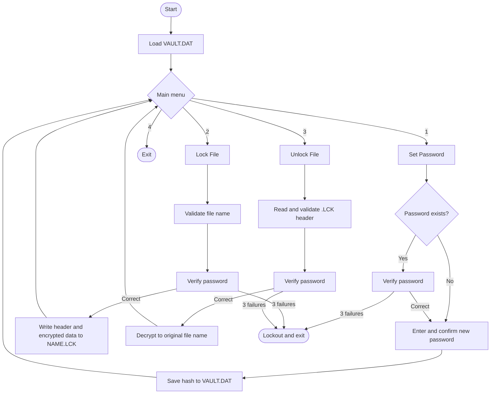
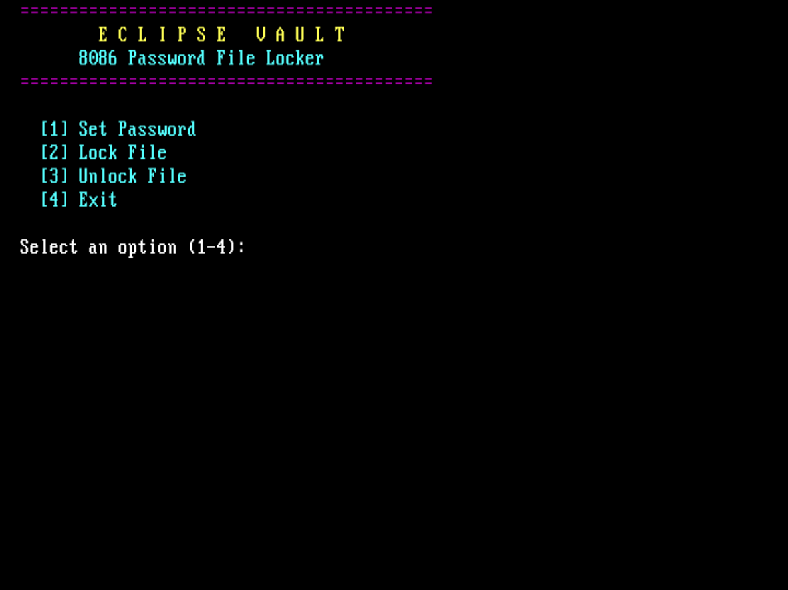
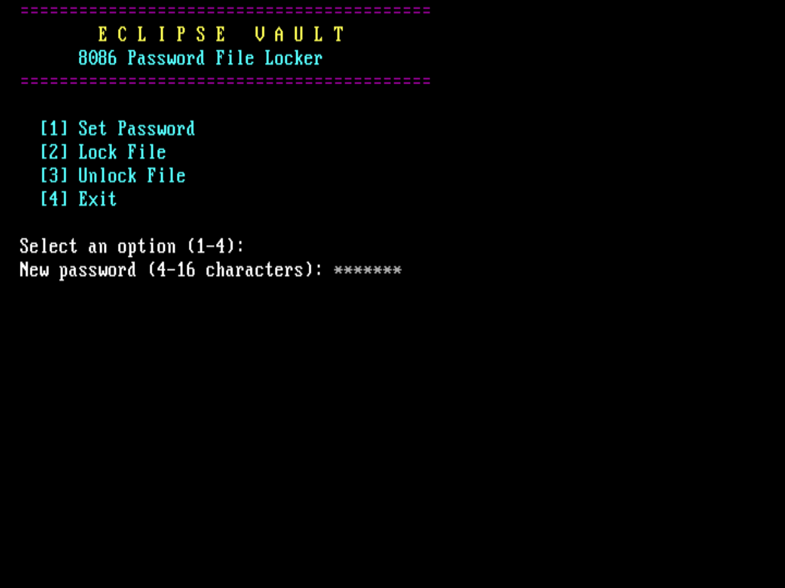
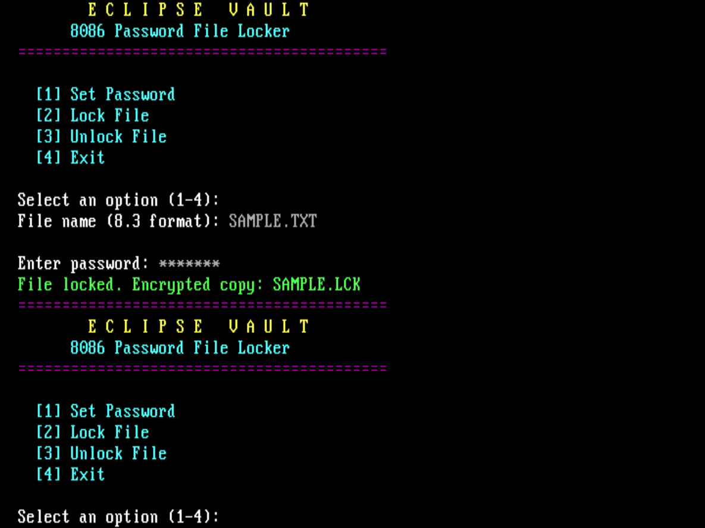
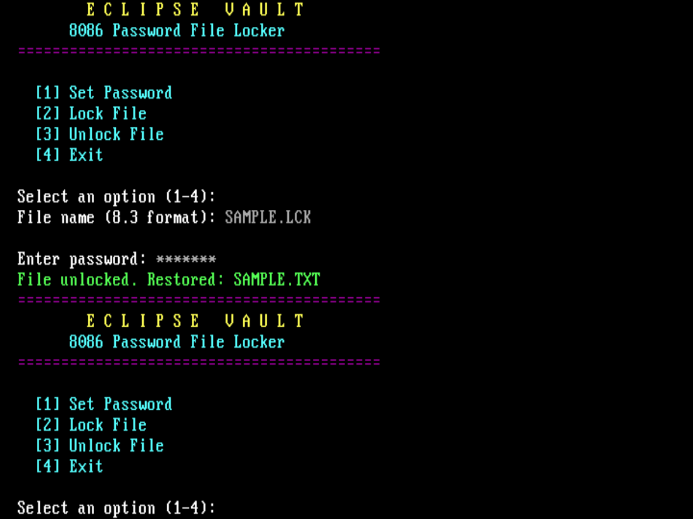

# Eclipse Vault 8086

**A password-protected file locker written entirely in 8086 Assembly Language.**


## About the Project

Eclipse Vault locks a file behind a password from a colored DOS menu. It was built to demonstrate low-level programming without any runtime library: registers, memory, string instructions, procedures, macros, and direct use of DOS and BIOS interrupts.

> **Security notice:** This is an educational project. XOR with a 16-bit generator and a 16-bit password hash can be broken, so do not use Eclipse Vault to protect real sensitive data.

## Features

- Colored text menu: Set Password, Lock File, Unlock File, Exit
- Masked password input (`*`) with Backspace support
- Password stored only as a hash in `VAULT.DAT`
- Lockout and program exit after 3 wrong attempts
- XOR encryption with a keystream derived from the password
- Files of any size processed in 512-byte blocks
- Original file name stored in the locked file and restored on unlock
- Existing files are never overwritten, and partial output is removed on failure
- Clear error messages for missing files, denied access, invalid names, and corrupt files

## Program Flow



## Tech Stack

- 8086 Assembly (MASM / TASM syntax)
- DOS interrupts (`INT 21h`): `3Ch`, `3Dh`, `3Eh`, `3Fh`, `40h`, `41h`, `4Ch`, `08h`
- BIOS video interrupts (`INT 10h`): `00h`, `09h`, `0Eh`
- DOSBox or EMU8086

## Screenshots

Captured from the program running in DOSBox.

| Main menu | Masked password |
| --- | --- |
|  |  |

| Lock a file | Unlock a file |
| --- | --- |
|  |  |

## Folder Structure

```
eclipse-vault-8086/
|-- src/
|   |-- eclipse.asm      Main program and procedures
|   `-- macros.inc       Constants and macros
|-- test-files/
|   `-- sample.txt       Fictional demo document
|-- docs/                Project report and presentation
|-- screenshots/         README images
|-- .env.example
`-- README.md
```

## How to Run Locally

### Option A: DOSBox with MASM

Put `MASM.EXE` and `LINK.EXE` in a folder such as `C:\ASM`, then run these commands in DOSBox. Replace the first path with your clone location.

```bat
mount c "C:\path\to\eclipse-vault-8086"
mount d "C:\ASM"
set PATH=%PATH%;D:\
c:
cd src
copy c:\test-f~1\sample.txt sample.txt
masm eclipse.asm;
link eclipse.obj;
eclipse
```

### Option B: DOSBox with TASM

Put `TASM.EXE` and `TLINK.EXE` in `C:\ASM`, then run:

```bat
mount c "C:\path\to\eclipse-vault-8086"
mount d "C:\ASM"
set PATH=%PATH%;D:\
c:
cd src
copy c:\test-f~1\sample.txt sample.txt
tasm eclipse.asm
tlink eclipse.obj
eclipse
```

### Option C: JWasm on Windows, run in DOSBox

From the repository root in a Windows terminal:

```bat
jwasm -mz -Isrc -Fosrc\ECLIPSE.EXE src\eclipse.asm
```

Then in DOSBox:

```bat
mount c "C:\path\to\eclipse-vault-8086"
c:
cd src
copy c:\test-f~1\sample.txt sample.txt
eclipse
```

### Option D: EMU8086

1. Copy `eclipse.asm` and `macros.inc` into the same folder.
2. Open `eclipse.asm` in EMU8086.
3. Click **Compile**, then **Emulate**, then **Run**.
4. Place `sample.txt` in the EMU8086 virtual drive, usually `C:\emu8086\vdrive\C`.

### Quick Demo

1. Press `1` and set a password such as `Orbit#42`.
2. Press `2`, enter `sample.txt`, and enter the password. This creates `SAMPLE.LCK`.
3. Run `del sample.txt` after exiting, then start `eclipse` again.
4. Press `3`, enter `sample.lck`, and enter the password. This restores `SAMPLE.TXT`.

## Environment Variables

The program needs no environment variables. `.env.example` provides optional placeholders for local helper scripts.

| Variable | Purpose |
| --- | --- |
| `DOSBOX_PATH` | Folder that contains DOSBox |
| `ASSEMBLER_PATH` | Folder that contains MASM, TASM, or JWasm |

## Design Decisions

- **Locking creates a copy.** The original stays in place until you delete it, so a failed write cannot destroy data.
- **Each locked file stores its own password hash.** Files remain recoverable after the vault password changes, using the password they were locked with.
- **Files stay in the current directory.** Paths are rejected, including in locked file headers.
- **Locked file format:** magic `EVLT` (4 bytes), original name (13 bytes), password hash (2 bytes), then encrypted data.

## Future Improvements

- Replace XOR with a stronger cipher such as RC4 or XTEA
- Use a random per-file salt and a stronger password hash
- Add an integrity checksum to detect modified files
- Support directory paths and batch locking

## Author

**Khizar Hayat** — BS Software Engineering, Riphah International University
LinkedIn: [linkedin.com/in/khizar-hayat-dev](https://linkedin.com/in/khizar-hayat-dev)
